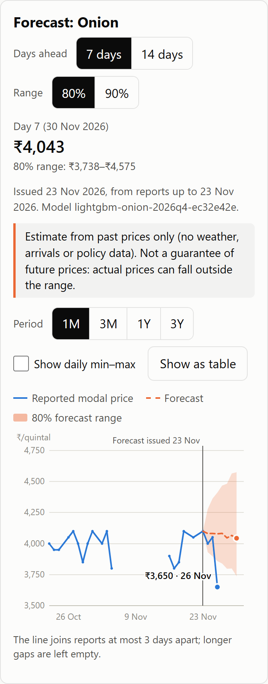
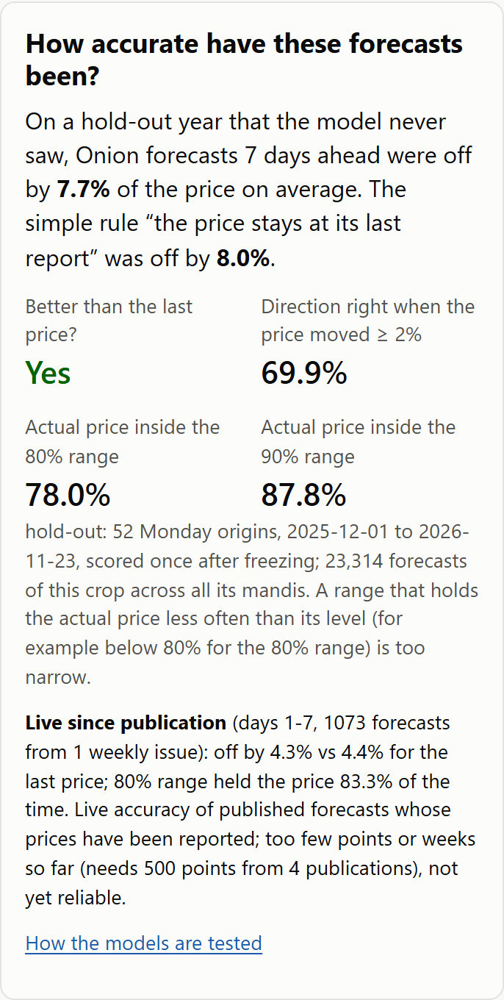
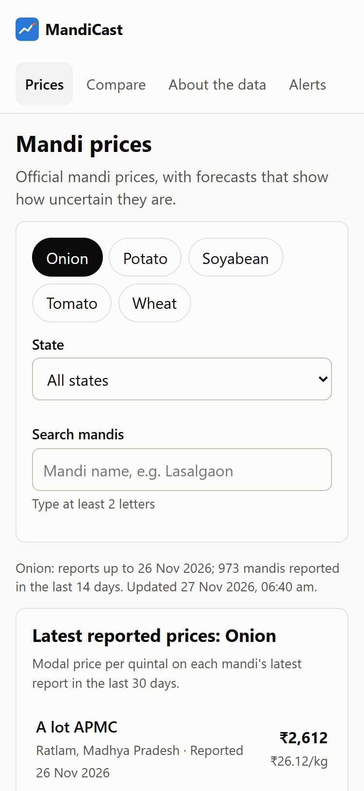
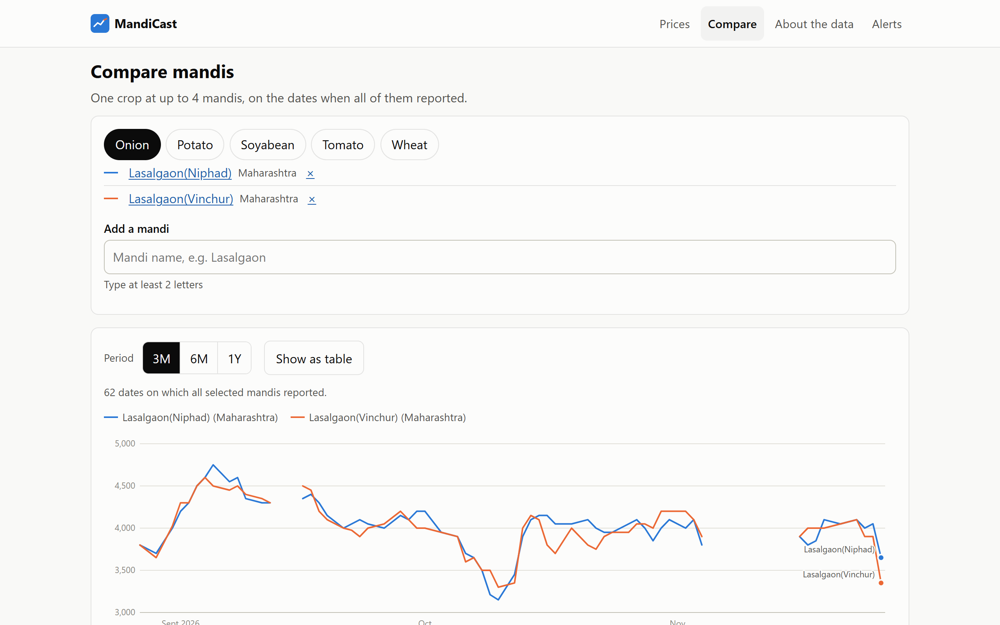
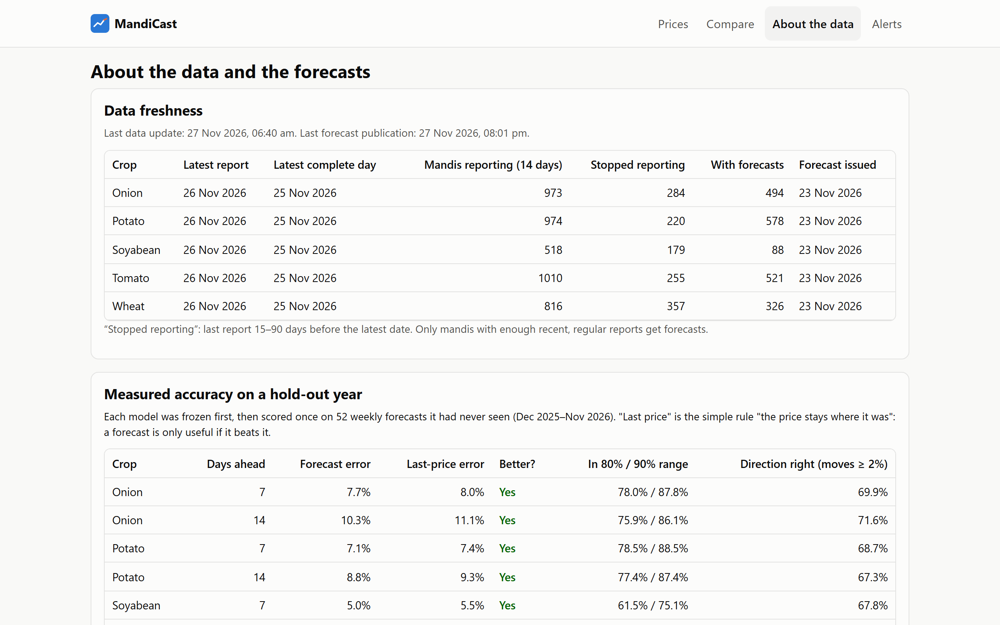
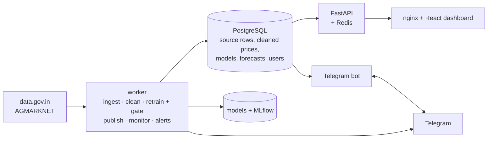

# MandiCast

[](https://github.com/HASHMATHALI/mandicast/actions/workflows/ci.yml)

Price intelligence for Indian agricultural wholesale markets (mandis): official daily prices, mandi comparisons, and
7- and 14-day price forecasts with ranges and their measured accuracy, through an API, a mobile-first dashboard and a
Telegram bot. **Forecasts are estimates from past prices, never guarantees.**

<table>
<tr>
<td></td>
<td></td>
<td></td>
</tr>
</table>

Screenshots from the running system on 2026-11-27 (real data). The first shows a real miss: the 26 Nov price at
Lasalgaon (₹3,650) fell below the 80% range.

<details><summary>Desktop: comparison and the data page</summary>




</details>

## What it does

- **Data:** 14.8 million official AGMARKNET price records for Onion, Tomato, Potato, Wheat and Soyabean (Jan 2001 –
  today) from data.gov.in, refreshed twice a day. Raw pages and source rows are kept unchanged; cleaning is a
  separate, replayable layer (names, quality flags, one price per mandi-day). Re-running any job changes nothing.
- **Forecasts:** a global LightGBM per crop, chosen on a development period and scored once on a hold-out year after
  every choice was frozen. Published weekly for every mandi with enough reliable data (2,003 at the first
  publication), with 80% / 90% ranges, the measured accuracy and warnings where it was weak.
- **MLOps:** quarterly retraining through a promotion gate (a deliberately worse model is rejected), rollback, live
  accuracy monitoring, drift checks, an audit trail and an MLflow registry.
- **Product:** FastAPI service (caching, rate limits, strict validation), React dashboard (history, forecast and range
  kept visually distinct; works at 375 px), Telegram bot with price and forecast alerts and password-free sign-in.
- **Engineering:** hardened Docker Compose, least-privilege database role, failure-mode tests, CI on GitHub, tested
  backups.

## Results (hold-out year 2025-12-01 – 2026-11-23, scored once)

| Crop | WAPE 7 d (model / last price) | WAPE 14 d (model / last price) | MASE 7 d / 14 d | Direction right, moves ≥ 2% (7 d) | 80% range held (7 d) |
|---|---|---|---|---|---|
| Onion | 7.7% / 8.0% | 10.3% / 11.1% | 0.960 / 0.923 | 69.9% | 78.0% |
| Tomato | 15.9% / 15.8% | 21.1% / 21.3% | **1.008** / 0.993 | 62.9% | 76.1% |
| Potato | 7.1% / 7.4% | 8.8% / 9.3% | 0.963 / 0.947 | 68.7% | 78.5% |
| Wheat | 2.3% / 2.6% | 2.8% / 3.2% | 0.893 / 0.885 | 77.3% | 76.4% |
| Soyabean | 5.0% / 5.5% | 7.0% / 7.4% | 0.909 / 0.935 | 67.8% | **61.5%** |

- Better than "the price stays where it is" in **9 of 10** crop × horizon cases; Tomato at 7 days is slightly worse.
- **Not met:** direction accuracy is 61–77% (the aspiration was ≥ 90%), and the ranges under-cover (Soyabean most).
  Both are shown to users. Details, method and caveats: [docs/10](docs/10_model_evaluation_report.md),
  [docs/06](docs/06_forecasting_methodology.md), [docs/19](docs/19_known_limitations.md).

## Architecture



Python 3.14, PostgreSQL 16, SQLAlchemy + Alembic, Polars, LightGBM, statsforecast, MLflow, FastAPI, Redis, APScheduler,
httpx; React 19, TypeScript, Vite, TanStack Query; Docker Compose, nginx, GitHub Actions. Details:
[docs/03](docs/03_architecture.md).

## Run it

```powershell
git clone https://github.com/HASHMATHALI/mandicast.git; cd mandicast
copy .env.example .env      # fill in DATA_GOV_IN_API_KEY, POSTGRES_PASSWORD, REDIS_PASSWORD, API_DB_PASSWORD
docker compose up -d --build
docker compose run --rm worker backfill             # official price history (resumable)
docker compose run --rm worker retrain              # this quarter's models, through the promotion gate
docker compose run --rm worker publish-forecasts
```

Open http://localhost:8090. Step by step, with timings, what each step was verified with, and troubleshooting:
[docs/18](docs/18_deployment_guide.md). **Known gap:** on a newly loaded database `publish-forecasts` stops, because
its ranges are calibrated on walk-forward predictions that are not in git (docs/18 §2); history, comparisons and the
API work. The data.gov.in key is free (`.env.example` says where to get it); a Telegram
bot token is optional.

**Development** (Python 3.12+, Node 22):

```powershell
python -m venv .venv
.venv\Scripts\python -m pip install -e ".[dev]"
docker compose up -d db redis
.venv\Scripts\python -m mandicast db-upgrade
.venv\Scripts\python -m mandicast api                  # http://127.0.0.1:8000/docs
cd dashboard; npm ci; npm run dev                      # http://localhost:5173
```

All commands: `python -m mandicast --help`; pipeline: [docs/09](docs/09_data_pipeline.md); operations:
[docs/15](docs/15_infrastructure.md).

## Tests

121 backend tests (real PostgreSQL and Redis; Telegram and data.gov.in mocked), 29 dashboard tests, 5 Playwright
end-to-end tests at 375 px and desktop, and CI on every push (backend, dashboard, image build and a fresh
deployment). The tests include leakage checks (deleting future data changes no feature), failure modes (outages,
schema changes, retraining crashes, notification failures) and checks that these documents match the code.
[docs/17](docs/17_testing_report.md).

```powershell
.venv\Scripts\python -m pytest              # needs: docker compose up -d db redis
cd dashboard; npm test; npm run test:e2e
```

## Repository layout

| Path | Contents |
|---|---|
| `src/mandicast/` | `ingest/` (API client, raw store, fetch, load), `clean/`, `forecast/` (Phase 3 evaluation; frozen), `serving/` (training, registry, gate, publication, monitoring), `bot/`, `api/`, `db/`, `jobs.py`, `pipeline.py`, `scheduler.py`, `cli.py` |
| `migrations/` | Alembic migrations 0001–0005 |
| `tests/` | Backend tests |
| `dashboard/` | React + TypeScript dashboard, its tests and Playwright tests |
| `experiments/forecast/` | Evaluation results the reports are generated from, frozen choices, development log |
| `reports/` | Data profile (Phase 1), verification and backtest results, per-job quality reports |
| `docker/`, `docker-compose.yml`, `.github/` | Images, Compose project, CI |
| `scripts/` | Research, verification, backtest, benchmark, backup and restore-check scripts |
| `docs/` | [Documentation index](docs/README.md): requirements, data sources, architecture, schema, methodology, API, reports per phase, MLflow guide, testing report, deployment guide, limitations, interview guide |

## Data and licence of the data

Prices come from AGMARKNET via the Open Government Data Platform India (data.gov.in), published by the Directorate of
Marketing and Inspection, Ministry of Agriculture and Farmers Welfare, under the
[Government Open Data License – India](https://www.data.gov.in/Godl). Prices are in ₹ per quintal as reported by the
market committees; the source does not guarantee their accuracy, and MandiCast is not endorsed by it.
[docs/02](docs/02_data_source_assessment.md).

## Security and privacy

Secrets live only in `.env` (git-ignored) and are passed to each container as needed; they are redacted from logs and
never copied into images. The public services use a database role that can change only account tables. Users are
identified only by their Telegram chat id; sign-in codes and session tokens are stored as hashes; `/delete` removes
everything. Details: [docs/15](docs/15_infrastructure.md), [docs/13](docs/13_telegram_alerts.md).

## Status

Phases 1–9 done (2026-11-27). Open: the manual end-to-end run with a real Telegram bot (needs a bot token), and
publishing forecasts from a fresh clone (above). Not deployed publicly. Progress log: [PROGRESS.md](PROGRESS.md).
