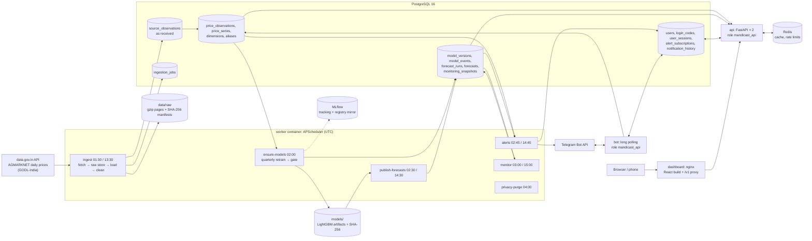

# MandiCast — Architecture

Version 1.0 (as built, 2026-11-27; Phase 1 draft 0.1 of 2026-11-26, changes in §7). Independent of VeriTrace: own
repository, database, runtime and CI. Deployment view and hardening: docs/15; steps: docs/18.

## 1. Overview

## 2. Components

| Component | Responsibility | Built with | Code |
|---|---|---|---|
| Fetcher | Pages and complete-date snapshots from the data.gov.in resource; retries with backoff; resumable backfill; boundary-date repair | httpx | `ingest/client.py`, `ingest/fetch.py` |
| Raw store | Every page and snapshot as received (gzip), SHA-256 and content hash per file, versioned date snapshots | files under `data/raw/` | `ingest/raw_store.py` |
| Loader | Source rows keyed by a hash of their fields (insert once); snapshot supersession with an outage guard; header check | SQLAlchemy Core, PostgreSQL | `ingest/load.py` |
| Cleaner | Canonical names and aliases, quality flags, one primary value per mandi-day (past data only), series statistics, eligibility | Polars + SQL | `clean/` |
| Jobs | One row per run, advisory lock, redacted errors, JSON quality reports | | `jobs.py`, `pipeline.py` |
| Forecasting (evaluation) | Baselines, AutoETS / AutoARIMA, global LightGBM; walk-forward; conformal intervals; freeze and one-time hold-out. Frozen: identified by the SHA-256 of its files | statsforecast, LightGBM, MLflow | `forecast/` (unchanged since freezing, except one verified docstring edit) |
| Serving | Quarterly training of the frozen method, artifact hashing, registry, publication with ranges, last-value forecasts, gate, rollback, monitoring, drift | LightGBM, MLflow | `serving/` |
| Scheduler | The jobs in the diagram; missed runs coalesce | APScheduler | `scheduler.py` |
| API | 24 operations on 23 paths under `/v1` (docs/07): discovery, prices, compare, trends, forecasts with accuracy and warnings, models, freshness, monitoring, health, sign-in, alerts | FastAPI, Pydantic, Redis | `api/` |
| Telegram bot and alerts | Commands, buttons, subscriptions, one-time sign-in links; idempotent alert delivery | httpx (Bot API, long polling) | `bot/` |
| Dashboard | Mobile-first UI: prices, mandi page with forecast and ranges, compare, data, alerts | React 19, TypeScript, Vite, TanStack Query, own SVG charts | `dashboard/` |
| Infrastructure | Compose services, hardened images, CI, backups | Docker Compose, nginx, GitHub Actions | `docker/`, `docker-compose.yml`, `.github/`, `scripts/` |

## 3. Data flow and idempotency

1. **Fetch.** A job row is created (`ingestion_jobs`, `running`). Pages and complete-date snapshots are stored with
   their hashes; an identical snapshot (even in another row order) is not stored again.
2. **Load.** Each source row gets `source_row_hash` (SHA-256 of its normalised fields); `source_observations` has a
   unique constraint on it and inserts use `ON CONFLICT DO NOTHING`, so re-running a job changes nothing. A newer
   complete snapshot of a date marks rows it no longer contains as superseded (never deleted); a shrunken snapshot is
   stored but not applied.
3. **Clean.** Cleaned rows are derived 1:1 from active source rows; source values are never overwritten. Flags record
   problems; one primary value per series and day is chosen with past data only.
4. **Train (quarterly).** Validation before training, then train → register → promotion gate → promote or reject;
   events in `model_events`, mirrored to MLflow.
5. **Publish (weekly origin, twice-daily attempts).** One run per crop and Monday; ranges from residuals whose
   targets precede the origin; never overwritten.
6. **Alert.** Due alerts get a `notification_history` row with an idempotency key; a re-run never messages twice.
7. **Monitor.** Published forecasts are scored as their target dates are reported (`monitoring_snapshots`).

## 4. Key decisions

| Decision | Reason |
|---|---|
| Keep raw pages and source rows unchanged; derive cleaned values separately | Traceability: every number shown leads to the published row; cleaning rules can be replayed |
| data.gov.in API, not third-party scrapes | Official, licensed (GODL-India), 83.3M rows back to 2001 |
| A series is (commodity, mandi); forecast only eligible series | Data quality differs widely; eligibility computed with data up to the origin |
| Pre-registered method, frozen code, one-time hold-out | Honest evaluation; the served model is provably the evaluated method |
| Quarterly retraining through a gate | The evaluated procedure; a worse model must not replace a better one |
| The database, not MLflow, is the source of truth for models | MLflow failures must not block serving |
| Long-polling Telegram bot | Works on a laptop without a public HTTPS endpoint |
| React dashboard behind nginx on one origin | Mobile-first UI; no CORS; strict CSP and header-only protections |
| Least-privilege database role for the public services | A compromised API cannot change prices or models |

## 5. Security and privacy

- Secrets only in `.env` (git-ignored), passed per container; redacted from logs; never in images.
- Strict input validation; SQL with bound parameters (identifiers quoted by the server where dynamic).
- Rate limits in Redis (HMAC-hashed client addresses) and at nginx; security headers and CSP.
- Personal data: Telegram chat id only, subscriptions and message history; codes and tokens stored as SHA-256;
  `/delete` or `DELETE /v1/me` removes everything; history purged after 12 months.
- Dependencies pinned (hash-checked Python lock, npm lockfile); `pip-audit` and `npm audit` in CI.

## 6. Environments

- **Development:** Windows, Python 3.14.5 venv, Node 22, PostgreSQL and Redis in Docker (published on 127.0.0.1).
- **Compose:** every service in containers (docs/15); dashboard on http://localhost:8090.
- **CI:** GitHub Actions: backend tests on service containers, dashboard checks, image build and a fresh deployment.
  No API key in CI: tests use recorded pages and mocks.

## 7. Changes from the Phase 1 design

- **Weekly retraining → quarterly** (the evaluated cadence; forecasts are still weekly).
- `training_runs` and `user_preferences` were not built: training is recorded in `ingestion_jobs`,
  `model_versions.training`, `model_events` and MLflow; subscriptions hold what a user follows.
- Bot uses the Bot API through httpx rather than python-telegram-bot (smaller, full control of retries and redaction).
- Forecasting uses statsforecast (ETS / ARIMA) and LightGBM; XGBoost was not needed.
- Added: model events and monitoring tables, last-value forecasts, drift, the least-privilege role, nginx in front.
- A series is (commodity, mandi), not (commodity, mandi, variety, grade) (methodology §1).
