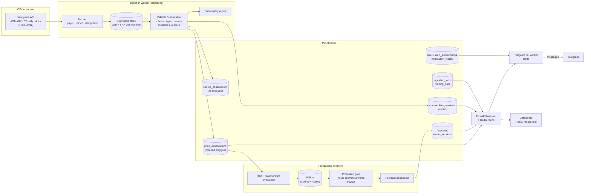

# MandiCast — Architecture

Version 0.1 (Phase 1 draft, 2026-11-26). Independent of VeriTrace: own repository, database, runtime, CI.

## 1. Overview

## 2. Components

| Component | Responsibility | Technology |
|---|---|---|
| Fetcher | Pull pages from the data.gov.in resource; daily incremental run for recent dates, backfill runs for history; retries with backoff; per-page SHA-256 manifest | Python, `httpx` (or stdlib), run by the worker |
| Raw page store | Keep every page exactly as received, so any cleaned value can be traced to a source row | Local volume (`data/raw/`), gzip CSV + JSONL manifest |
| Validator / normaliser | Explicit parsing (dates `dd/mm/yyyy`, prices), alias tables for states / districts / markets / commodities, duplicate and conflict detection, outlier flags, quality report | Python, Polars |
| PostgreSQL | System of record: source rows, cleaned observations, dimensions, forecasts, model versions, users, alerts, jobs | PostgreSQL 16, SQLAlchemy 2, Alembic |
| Scheduler | Daily ingestion, weekly training, alert evaluation after each ingestion; job rows record status and are safe to re-run | APScheduler in a `worker` container, with a DB-backed job table |
| Forecasting | Baselines, statistical models, gradient boosting; walk-forward evaluation; intervals; promotion gate; batch forecast generation | Python: statsforecast / statsmodels, LightGBM or XGBoost (chosen in Phase 3 from results), MLflow |
| Backend API | Read APIs for discovery, history, comparison, forecasts, trends, freshness, model info; alert management | FastAPI, Pydantic, Redis for response caching and rate limiting |
| Telegram bot | Crop / mandi selection, current prices, forecasts on request, alert subscriptions and notifications | python-telegram-bot, long polling (no public webhook needed) |
| Dashboard | Mobile-first UI for non-technical users | React + TypeScript (Vite), charts with clear history / forecast / interval styling |
| Infrastructure | One `docker compose up` for db, redis, api, worker, bot, dashboard, mlflow | Docker Compose, GitHub Actions CI |

## 3. Data flow and idempotency

1. **Fetch.** A job row is created (`ingestion_jobs`, status `running`). Pages are fetched for the requested
   scope (commodity and date window) and stored with their hash. A page already stored with the same hash is
   not stored again.
2. **Load source rows.** Each source row gets a deterministic `source_row_hash` (SHA-256 of the normalised
   raw fields). `source_observations` has a unique constraint on it, and inserts use
   `ON CONFLICT DO NOTHING`, so re-running a job cannot create duplicates.
3. **Clean.** Cleaned observations are derived from source rows. The source value is never overwritten:
   corrections and flags live in `price_observations` with a reference to the source row and a reason code.
4. **Quality report.** Counts of rejected, flagged and conflicting rows per job, and per-mandi reporting
   lag, are written to the job record and exposed by the freshness API.
5. **Forecast.** Weekly (and after large backfills): train candidate models, evaluate walk-forward, compare
   with the production model on the same folds, and promote only if the gate passes. Forecasts are written
   with the model version that produced them.
6. **Alert.** After each successful ingestion (and after forecasts are refreshed), subscriptions are
   evaluated; each notification is recorded in `notification_history` with an idempotency key, so a re-run
   does not message a user twice.

## 4. Key decisions

| Decision | Reason |
|---|---|
| Keep raw pages and source rows unchanged; derive cleaned values separately | Master requirement; makes every displayed number traceable and every cleaning rule reversible |
| Use the data.gov.in API, not third-party scrapes | Official, licensed (GODL), verified to hold 83.3M rows back to 2001 |
| Arrivals out of scope for v1 | No documented bulk access (data source assessment §1) |
| Forecast at the (mandi, commodity, variety, grade) series level, only where sufficiency rules pass | Prices differ by variety and grade; series quality varies widely |
| Long-polling Telegram bot | Works on a laptop and in CI without a public HTTPS endpoint |
| React dashboard rather than Streamlit | Mobile-first usability is a requirement; Node 22 is available on the dev machine |
| MLflow with a local backend store in Compose | Experiment tracking and a registry without external services |

## 5. Security and privacy
- Secrets only from environment (`.env`, git-ignored); the API key is never logged (verified in Phase 1
  scripts) and is redacted from request logs.
- Public read API has rate limits (Redis). Alert management requires a token issued through the Telegram bot.
- Stored personal data: Telegram chat id, optional display name, preferences, subscriptions, notification
  history. Users can delete all of it with a bot command; retention rules in the database schema document.
- Input validation on every parameter (Pydantic); SQL only through SQLAlchemy with bound parameters.
- Dependencies pinned; `pip-audit` (and `npm audit`) in CI.

## 6. Environments
- **Local:** Docker Compose. The Docker daemon was not running on 2026-11-26; it must be running from
  Phase 4 on. Phases 1–3 run in a local virtual environment (`.venv`, Python 3.14.5).
- **CI:** GitHub Actions: lint, type check, unit and integration tests (PostgreSQL service container), and
  tests that use recorded API pages instead of live calls (no key in CI). Needs a GitHub repository.
