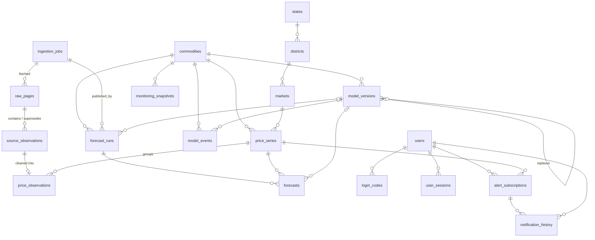

# MandiCast — Database Schema (PostgreSQL 16)

Version 0.5 (2026-11-27). The ingestion, source, dimension and cleaned-observation tables are **implemented**
(`src/mandicast/db/models.py`, Alembic revisions `0001`–`0005`, applied to PostgreSQL 16.16). Forecasting tables
were added in Phase 4, MLOps in Phase 5, users and alerts in Phase 6. Field-level meanings are in `05_data_dictionary.md`.

**Changes made while implementing (Phase 2)**
- A series is (commodity, mandi), not (commodity, mandi, variety, grade): see methodology §1. Variety and grade
  are columns of `price_observations`; `price_series` stores the dominant (variety, grade) of the last year.
- `raw_pages` also holds complete-date snapshots (`kind = 'by_date'`, `arrival_date` set).
- `source_observations` has a parsed `arrival_date` (indexed with `commodity_raw`) and
  `superseded_by_raw_page_id`: the only column ever updated, set when a newer complete snapshot of that date no
  longer contains the row (and cleared if a later snapshot contains it again).
- `price_observations` has one row per active source row (unique `source_observation_id`), so lineage is 1:1;
  the partial unique index `uq_price_obs_primary (series_id, date) WHERE is_primary` enforces one value per day.
- `name_aliases` stores `canonical_name` (the lower-case key), the rule (`exact`, `whitespace`, `state_rename`,
  `apmc_suffix`, `manual`) and `last_seen`. `states`, `districts` and `markets` keep the key in `name` plus
  `display_name` / `display_seen` (most recent source spelling; replaced only by a spelling seen at least as
  recently). Added in Alembic revision `0002`.

## 1. Entity relationships

As built at Alembic `0005`: the 20 tables and every foreign key in the database (checked against
`information_schema` on 2026-11-27). `name_aliases` maps each source spelling to a canonical key
(`entity`, `parent_key`, `canonical_name`), which equals the `name` key of a state, district or market (e.g.
`andhra pradesh`, shown as `display_name`); it has no foreign key. The five commodities need no aliases. Every column: `05_data_dictionary.md` §5.

## 2. Tables

### Ingestion and source data (append-only)

| Table | Key columns | Notes |
|---|---|---|
| `ingestion_jobs` | `id` PK, `kind` (every scheduled or manual job: `backfill`, `daily`, `load_raw`, `clean`, `train_models`, `retrain`, `ensure_models`, `rollback`, `publish_forecasts`, `monitor`, `alerts`, …), `scope` JSONB (commodity, date window), `status` (`running` / `succeeded` / `failed` / `skipped`), `started_at`, `finished_at`, `rows_fetched`, `rows_inserted`, `rows_rejected`, `quality_report` JSONB, `error` | One row per run; a failed job can be re-run safely |
| `raw_pages` | `id` PK, `job_id` FK, `resource_id`, `request_params` JSONB (no key), `offset`, `rows`, `sha256` UNIQUE, `file_path`, `fetched_at` | Mirrors the downloader manifest; the file itself stays on disk |
| `source_observations` | `id` BIGINT PK, `raw_page_id` FK, `source_row_hash` CHAR(64) **UNIQUE**, all source fields as received (`arrival_date_raw`, `state_raw`, `district_raw`, `market_raw`, `commodity_raw`, `commodity_code_raw`, `variety_raw`, `grade_raw`, `min_price_raw`, `max_price_raw`, `modal_price_raw` — TEXT), `first_seen_at` | Never updated. `INSERT … ON CONFLICT (source_row_hash) DO NOTHING` makes loads idempotent |

### Dimensions

| Table | Key columns | Notes |
|---|---|---|
| `states` | `id`, `name` UNIQUE | Cleaned name (e.g. one row for Kerala / Keralam) |
| `districts` | `id`, `state_id` FK, `name`; UNIQUE (`state_id`, `name`) | |
| `markets` | `id`, `district_id` FK, `name`, `first_reported`, `last_reported`; UNIQUE (`district_id`, `name`) | |
| `commodities` | `id`, `name` UNIQUE, `agmarknet_code`, `price_unit` (default `INR_per_quintal`) | |
| `name_aliases` | `id`, `entity` (`state` / `district` / `market` / `commodity`), `parent_key` (the canonical key of the parent area; `''` for states and commodities), `raw_name`, `canonical_name` (the key the spelling maps to), `rule` (`exact` / `whitespace` / `state_rename` / `apmc_suffix` / `manual`), `created_at`, `last_seen` | Every source spelling maps to one cleaned entity; manual mappings are reviewed |

### Cleaned observations

| Table | Key columns | Notes |
|---|---|---|
| `price_series` | `id`, `commodity_id`, `market_id`, `variety`, `grade`; UNIQUE on all four; `first_date`, `last_date`, `n_days`, `eligible_for_forecast` BOOL, `eligibility_reason` | Recomputed after each load |
| `price_observations` | `id` BIGINT PK, `series_id` FK, `date` DATE, `min_price`, `max_price`, `modal_price` NUMERIC(12,2), `source_observation_id` FK, `flags` TEXT[], `is_primary` BOOL | One primary row per (`series_id`, `date`); conflicting source rows for the same key are kept, flagged `conflict`, and only one is primary according to a documented rule |

Indexes: `price_observations (series_id, date)` UNIQUE WHERE `is_primary`; `price_observations (date)` BRIN
(append-mostly time data); `price_series (commodity_id, market_id)`; `markets (district_id)`.
If the table grows beyond tens of millions of rows, partition `price_observations` by range on `date` (yearly).

### Forecasting (implemented in Phase 4, Alembic revision `0003`)

| Table | Key columns | Notes |
|---|---|---|
| `model_versions` | `id`, `version` UNIQUE (e.g. `lightgbm-onion-2026q4-ec32e42e`: method, crop, quarter, first 8 hex of the artifact hash), `kind`, `commodity_id`, `horizon_days` (14: serves days 1–14), `training_cutoff`, `valid_from` / `valid_to` (the quarter it may serve), `artifact_path` + `artifact_sha256` (checked on every load), `code_sha256` (forecasting code), `params`, `training` (rows, best iteration, data date, MLflow run), `evaluation` (the hold-out metrics shown by the API), `interval_method`, `status` (`candidate` / `production` / `archived` / `rejected`), `promoted_at`, `replaced_version_id` | Partial unique index: one `production` version per commodity |
| `forecast_runs` | `id`, `job_id`, `model_version_id`, `origin` (a Monday), `data_complete_through`, `series_eligible`, `series_forecast`, `calibration` JSONB (window, residual counts); UNIQUE (`model_version_id`, `origin`) | One publication; re-running it is a no-op |
| `forecasts` | `id`, `run_id`, `series_id`, `model_version_id`, `issued_on`, `target_date`, `horizon_days`, `last_date`, `last_price`, `point`, `lower80`, `upper80`, `lower90`, `upper90`, `volatility_tercile`; UNIQUE (`series_id`, `model_version_id`, `issued_on`, `target_date`) | Checks: `target_date = issued_on + horizon_days`, nested intervals (`lower90 ≤ lower80 ≤ upper80 ≤ upper90`; conformal intervals need not contain the point). Never updated; kept after the target date for monitoring |

`training_runs` from the Phase 1 design is not a table: training is recorded in `ingestion_jobs` (kind
`train_models`, later `retrain`), in `model_versions.training`, in `model_events` (Phase 5) and in MLflow
(`experiments/mlflow.db`, experiment `mandicast-serving`, from Phase 5 `mandicast-models`; docs/16). Forecast
publications are `ingestion_jobs` of kind `publish_forecasts`.

### MLOps (Phase 5, Alembic revision `0004`)

| Table / change | Key columns | Notes |
|---|---|---|
| `model_versions` + | `gate` JSONB (promotion-gate result, C10b), `status_reason`, `mlflow_registry_version` | The MLflow registry is a mirror; this table is the source of truth |
| `model_events` | `id`, `commodity_id`, `model_version_id` (NULL for crop-level events), `event` (`registered` / `promoted` / `rejected` / `rolled_back` / `archived` / `fallback`), `reason`, `details` JSONB, `created_at` | Audit trail of every lifecycle decision |
| `forecast_runs` + | `commodity_id` (UNIQUE with `origin`: one publication per crop and week), `model_version_id` now nullable (last-value-only runs), `decisions` JSONB (fallback per day range, C10c), `drift` JSONB (PSI, C10e) | |
| `forecasts` + | `model_point` (the model's own value, kept even when last value is served), `served_by` (`model` / `last_value`); `model_version_id` nullable; UNIQUE (`run_id`, `series_id`, `target_date`) | Existing rows were back-filled with `model_point = point`, `served_by = 'model'` |
| `monitoring_snapshots` | `as_of`, `commodity_id`, `day_range` (`1-7` / `8-14`), `origins`, `points`, `wape_model`, `wape_last_value`, `wape_served`, `coverage80`, `coverage90`, `direction_moves_ge_2pct`, `details`; UNIQUE (`as_of`, `commodity_id`, `day_range`) | Live accuracy of published forecasts, one row per day |

### Users and alerts (implemented in Phase 6, Alembic revision `0005`)

| Table | Key columns | Notes |
|---|---|---|
| `users` | `id`, `telegram_chat_id` UNIQUE, `language` (default `en`), `created_at`, `last_seen_at` | The only personal datum is the chat id: no name, username or phone. Deleted rows are removed, not flagged (no `deleted_at`) |
| `login_codes` | `id`, `user_id` (CASCADE), `code_sha256` UNIQUE, `expires_at` (15 min), `used_at` | One-time dashboard sign-in codes from the bot's `/login`; only hashes stored |
| `user_sessions` | `id`, `user_id` (CASCADE), `token_sha256` UNIQUE, `expires_at` (30 days), `last_used_at` | Bearer tokens for the dashboard; only hashes stored |
| `alert_subscriptions` | `id`, `user_id` (CASCADE), `series_id`, `condition_type` (`price_above` / `price_below` / `forecast_change_pct`), `threshold` > 0, `active`, `last_evaluated_date`, `last_condition`, `last_forecast_run_id`; UNIQUE (`user_id`, `series_id`, `condition_type`, `threshold`) | At most 20 per user; paused if Telegram reports the user blocked the bot |
| `notification_history` | `id`, `subscription_id` (CASCADE), `user_id` (CASCADE), `idempotency_key` UNIQUE, `status` (`pending` / `sent` / `failed`), `message`, `attempts`, `error`, `created_at`, `sent_at` | Key = subscription + report date (price) or + forecast run (forecast): a re-run never messages twice |

`user_preferences` from the Phase 1 design was not built: subscriptions already record the crops and mandis a user
follows, and nothing else needed preferences.

## 3. Retention and deletion
- Source and cleaned price data: kept (public data, needed for reproducibility).
- `notification_history`: 12 months, then deleted (`privacy-purge`, daily 04:00 UTC).
- `user_sessions` and `login_codes`: deleted after expiry (same job).
- A user's `/delete` command (or `DELETE /v1/me`) removes their user row, preferences, subscriptions,
  sessions and notification history immediately.
