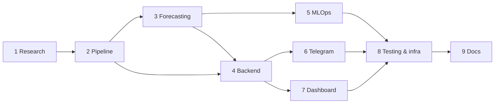

# MandiCast — Development Roadmap

Version 0.1 (2026-11-26). Each phase follows Research → Design → Implement → Verify → Document → Report, and
is complete only when its exit criteria pass. Estimates are working sessions on the current laptop (no GPU).

| Phase | Deliverables | Exit criteria | Needs from the owner | Estimate |
|---|---|---|---|---|
| 1. Research and architecture | Product requirements, data source assessment, architecture diagram, database schema, data dictionary, forecasting methodology, API specification, this roadmap; profiling of 5 commodities | Every source claim verified and recorded; profiling report from real downloaded data; design decisions follow from it | data.gov.in API key ✅ (2026-11-26) | 1 day |
| 2. Data pipeline | Package `mandicast`: fetcher, raw store, validation, normalisation, alias tables, duplicate/conflict handling, outlier flags, quality report, PostgreSQL storage, incremental + backfill jobs, retries, logging | ≥ 1M real observations loaded; re-running any job creates no duplicates (tested); quality report produced; tests pass | PostgreSQL: Docker running, or a local install | 1.5–2 days |
| 3. Forecasting engine | Baselines (last value, seasonal naive, moving average), ETS / (S)ARIMA, gradient boosting with lag and calendar features; walk-forward evaluation; intervals; sufficiency rules; evaluation report | Every model compared with baselines on the same folds; metrics per crop / mandi group / horizon; interval coverage measured; results in MLflow | — | 2–3 days |
| 4. Backend and database | FastAPI + SQLAlchemy + Alembic + Redis; endpoints from the API specification; indexes for time-series queries | API integration tests against a real PostgreSQL; documented error handling | **Docker Desktop running** | 1.5–2 days |
| 5. MLOps and retraining | MLflow registry, weekly retraining, validation before training, promotion gate, rollback, monitoring of error, missing updates and drift | A deliberately worse model is not promoted (tested); rollback tested | — | 1–1.5 days |
| 6. Alerts and Telegram | Bot: crop and mandi selection, prices, forecasts, subscriptions, notifications with idempotency | Bot tests with a mocked Telegram API; one manual end-to-end run with a real bot | **Telegram bot token** (from @BotFather) | 1 day |
| 7. Dashboard | React mobile-first UI: search, filters, history, comparison, 7/14-day forecasts with intervals, freshness, accuracy, alert management | Usable on a 375 px wide screen; history / forecast / interval visually distinct; end-to-end test | — | 1.5–2 days |
| 8. Testing, infrastructure, deployment | Docker Compose for all services, GitHub Actions CI, failure-mode tests (duplicate ingestion, missing records, invalid prices, schema change, API failure, retraining failure, insufficient data, rollback, notification failure), structured logging, deployment and backup docs | CI green on GitHub; failure-mode tests pass | **GitHub repository** | 1–1.5 days |
| 9. Final documentation | README, architecture, data sources, data dictionary, ETL, forecasting methodology, walk-forward report, model comparison, MLflow guide, API docs, testing report, deployment guide, known limitations, interview guide | Docs match what exists and was run | — | 0.5–1 day |

Total: about 11–15 working days.

Phase 5 note (2026-11-27): retraining is quarterly, the cadence that was evaluated (methodology D1, C6); "weekly retraining"
above was the Phase 1 plan. Forecasts are still issued weekly. See docs/12.

## Order of work and dependencies

## Risks

| Risk | Mitigation |
|---|---|
| data.gov.in rate limits or outages during backfill | Resumable downloader with backoff; raw pages kept, so loading never depends on re-downloading |
| Source schema changes (field names, types) | Header check on every page; adapters per resource; failing loudly with a test for it |
| Many short or gappy series | Sufficiency rules; forecasts only where supported; global models pooling series of a commodity |
| 90% directional accuracy not achievable | Report the measured value with its reasons; never tune on the test window |
| Docker not available | Phases 1–3 run in `.venv`; Phase 4 onward needs Docker (or local PostgreSQL and Redis) |
