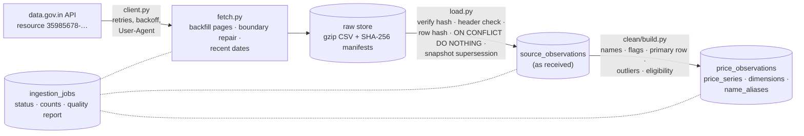

# MandiCast — Data Pipeline (Phase 2)

How official AGMARKNET prices get from data.gov.in into PostgreSQL, and what guarantees each step gives.
Code: `src/mandicast/`. Tests: `tests/` (33, run against a real PostgreSQL test database).

## 1. Flow

## 2. Commands

| Command | What it does |
|---|---|
| `docker compose up -d db` | PostgreSQL 16.16 on 127.0.0.1:5433 (credentials from `.env`) |
| `python -m mandicast db-upgrade` | Apply Alembic migrations |
| `python -m mandicast load-raw [--commodity X]` | Load stored raw files (no network), then rebuild the cleaned layer |
| `python -m mandicast backfill [--commodity X]` | Download full history (pages + boundary repair), load, clean |
| `python -m mandicast daily [--commodity X]` | Re-fetch the last 7 arrival dates up to today (IST), load, clean from the first re-fetched date |
| `python -m mandicast clean [--since YYYY-MM-DD]` | Rebuild the cleaned layer |
| `python -m mandicast status` | Row counts, eligibility per commodity, last 5 jobs |
| `python -m mandicast worker` | Scheduler: `daily` at 01:30 and 13:30 UTC |

## 3. Guarantees and how they are achieved

| Requirement (master instruction) | Mechanism | Test |
|---|---|---|
| Official source ingestion | `DataGovClient` against the data.gov.in resource; key from `.env` | `test_client_and_logging.py` (local test server) |
| Retry mechanisms | Exponential backoff 5 s → 10 min on 429/5xx, timeouts, resets, DNS errors (≈ 40 min in total) | `test_retries_transient_errors_then_succeeds`, `test_gives_up_after_retries…` |
| Data validation | Header must equal the verified 11 columns (else `SchemaChangeError`, whole load rolled back); every file checked against its SHA-256 | `test_header_change_is_rejected`, `test_schema_change_rolls_back_the_whole_load`, `test_tampered_file_is_detected` |
| Historical storage, keep original records | Raw responses kept as received; `source_observations` keeps all 11 fields as text; cleaned values in a separate table | `test_apmc_rename_merges_series_and_nothing_is_invented` |
| Idempotent processing, duplicate detection | Files loaded once (`raw_pages.file_path` unique); rows keyed by SHA-256 of their fields with `ON CONFLICT DO NOTHING`; cleaned rows 1:1 with active source rows; rebuilds deterministic | `test_load_is_idempotent`, `test_rebuild_is_deterministic`, `test_backfill_then_daily_is_idempotent…` |
| Incremental ingestion | Daily re-fetch of the last 7 dates (late reports); unchanged snapshots not stored again; cleaning rebuilt only from the first re-fetched date (with 400 days of context) | `test_backfill_then_daily…`, `test_identical_date_snapshot_is_not_stored_twice` |
| Corrections at the source | A complete newer snapshot of a date supersedes rows it no longer contains (never deletes them) | `test_newer_snapshot_supersedes_rows_it_no_longer_contains` |
| Outage safety | A snapshot with no rows or < 90% of the rows active before it is stored and reported but not applied | `test_shrunken_snapshot_is_stored_but_not_applied` |
| Pagination correctness on a live index | Dates split across pages are re-fetched whole (Phase 1 found 79 rows otherwise missed) | `test_boundary_dates_and_repair`, `test_date_snapshot_recovers_rows_missing…` |
| Missing values never invented | No filling; days without reports have no row; zero bounds stored as NULL with a flag | `test_flags_and_bounds_not_reported`, `test_apmc_rename…` (cleaned days = source days) |
| Outlier detection, quality flags | Flags per `05_data_dictionary.md` §3; trailing-only outlier rule | `test_flags_and_bounds_not_reported`, `test_local_outlier_is_flagged_from_past_values` |
| No look-ahead in derived values | Primary row chosen from the previous 365 days only | `test_primary_choice_uses_only_past_data` |
| Logging, safe logging | JSON log lines; registered secrets, `api-key=` values and URL passwords masked | `test_redaction…`, `test_log_filter_redacts_messages_and_exceptions` |
| Job records, no overlapping runs | `ingestion_jobs` row per run (succeeded / failed with redacted error / skipped); PostgreSQL advisory lock | `test_job_success_and_failure…`, `test_concurrent_run_is_skipped`, `test_daily_without_loaded_data…` |
| Scheduled workers | APScheduler, twice daily, one instance, coalesced (later phases added publication, model checks, monitoring, alerts and the privacy purge: docs/18 §3) | `test_scheduler_registers_ingestion_and_publication_without_overlap` |
| Data quality reporting | Per-job JSON in `reports/quality/` and `ingestion_jobs.quality_report`: rows read/inserted/duplicate, snapshots applied/not applied, superseded rows, flag counts, alias rules used, series and eligible series, origin date | inspected in §4 |

## 4. Verification on the real data (2026-11-26)

Computed by `scripts/verify_phase2.py` from the database and the raw files (`reports/phase2_verification.json`),
after the full load (jobs 1 and 3), the full rebuild (job 9) and four live daily runs (jobs 6, 7, 8, 10).

| Commodity | API total | Source rows in DB (= distinct raw rows) | Cleaned rows | Primary mandi-days | Series | Eligible | Origin |
|---|---|---|---|---|---|---|---|
| Onion | 3,425,173 | 3,425,172 | 3,425,172 | 3,245,913 | 2,636 | 494 | 2026-11-23 |
| Tomato | 3,055,643 | 3,055,635 | 3,055,635 | 3,008,704 | 2,470 | 519 | 2026-11-24 |
| Potato | 3,492,438 | 3,492,418 | 3,492,418 | 3,400,928 | 2,349 | 578 | 2026-11-24 |
| Wheat | 3,559,803 | 3,559,803 | 3,559,803 | 3,133,813 | 2,521 | 324 | 2026-11-23 |
| Soyabean | 1,294,978 | 1,294,978 | 1,294,978 | 1,189,077 | 1,334 | 88 | 2026-11-23 |
| **Total** | 14,828,035 | **14,828,006** | 14,828,006 | 13,978,435 | 11,310 | **2,003** | |

- Source rows = API total minus rows the source itself repeats exactly (Onion 1, Tomato 8, Potato 20).
- All checks pass for every commodity: every raw file loaded; source rows equal the distinct rows over all raw
  files; one cleaned row per active source row; one primary row per mandi-day with a valid report; 0 orphan
  cleaned rows; 0 duplicate primary days; 0 cleaned rows from superseded sources.
- Series counts equal the Phase 1 canonical mandi counts exactly. Eligible series: 2,003 (Phase 1 estimate with
  its approximate flags: 2,033); the pipeline's flag definitions (trailing outlier rule, same-day duplicates of
  renamed mandis not counted as invalid) are the authoritative ones.
- Live incremental runs: the first fetched 23,629 rows for 18–25 Nov 2026 (26 Nov empty) and inserted 0 new rows
  (no late reports since the morning download); runs after the snapshot fix stored 0 files and changed nothing.
  Name labels were identical before and after a daily (windowed) rebuild.
- Locking verified live: a `daily` started during a load was recorded as `skipped` (exit code 3).
- Timing on the development laptop: full load + clean of 14.8M rows ≈ 45 min; full rebuild ≈ 22 min;
  a daily run for five commodities ≈ 3 min.

## 4a. Problems found and fixed during Phase 2 (all covered by tests now)

| Problem (found on real data) | Fix |
|---|---|
| Dates with no records return HTTP 200 with an empty body (no header); the first live daily run failed safely on today's date | Empty date responses are counted (`dates_empty`) and not stored |
| Exact-date responses list rows in a different order on each request, so byte hashes differ for identical content | Snapshots compared by an order-independent content hash; identical content is not stored again |
| Equal bytes fetched again after a different version got the same file name (and a clock-based name could still collide within one second, caught by an intermittent test failure) | Snapshot files are named with a per-date version number (`<date>__<sha8>__v0003`); manifest entries de-duplicated on read |
| A correcting snapshot was compared with an active count that already included its own new rows | Compared with the rows active before the snapshot |
| Name rule labels depended on the rebuild window | Labels are structural; display names stored with the date last seen and replaced only by newer spellings |
| Parallel queries failed with "No space left on device" (Docker's 64 MB `/dev/shm`) | `shm_size: 1gb` for the database container |
| Eligibility counted conflicts only when the primary row itself conflicted | Day-level flag `day_has_conflicting_reports`, as the methodology defines |

## 5. Known limitations
- Mandis renamed in Nov 2025 whose new name is not "old name + APMC" (11–17% of active "APMC" names) are
  not linked yet; they need reviewed entries in `config/manual_aliases.csv`.
- Arrival quantities are not ingested (no bulk official source).
- The cleaned layer is rebuilt per commodity from a start date; a full rebuild of a 3.5M-row commodity takes a
  few minutes on the development laptop.
