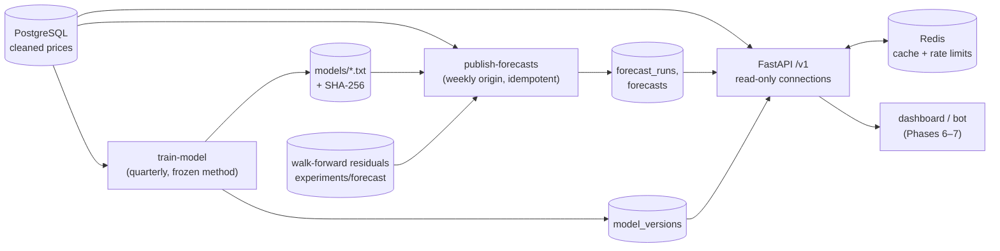

# MandiCast — Backend, Serving and API (Phase 4)

Date: 2026-11-27. API reference: `docs/07_api_specification.md` and the live OpenAPI document (`/docs`).
Serving rules: `docs/06_forecasting_methodology.md` §9a (C9). Every number below comes from a command run on
2026-11-27 (outputs in `reports/phase4/`, `reports/quality/job_*.json`, `logs/`).

## 1. What was built

| Part | Where | What it does |
|---|---|---|
| Schema | `migrations/versions/0003_*`, `db/models.py` | `model_versions`, `forecast_runs`, `forecasts` (docs/04) |
| Training | `serving/registry.py`, `mandicast train-model` | Trains the frozen LightGBM for the origin's quarter on the current database, saves the artifact with its SHA-256, logs to MLflow, registers and promotes it (one production model per crop). Refuses if the evaluated forecasting code changed (C9b) |
| Publication | `serving/publish.py`, `mandicast publish-forecasts` | Latest Monday with complete data; eligible series at that origin; point forecasts from the production model; volatility-conditional conformal ranges from residuals whose targets precede the origin (C9c); one run per model and origin, never overwritten |
| API | `api/` (`app.py`, `routes/`, `limits.py`, `deps.py`, `errors.py`, `schemas.py`), `mandicast api` | 15 endpoints: discovery, prices, compare, trends, forecasts, eligibility, models, freshness, health |
| Scheduling | `scheduler.py` | Ingestion at 01:30 and 13:30 UTC; publication at 02:30 and 14:30 UTC (no-op when the week is already published) |
| Infrastructure | `docker-compose.yml` | Redis 8 (digest-pinned, password, localhost only, no persistence, 128 MB LRU) next to PostgreSQL |

## 2. Serving models and first publication

The serving models are the frozen method retrained for 2026Q4 (cutoff 2026-10-01). Each reproduces the fit that the
hold-out evaluation made for the same quarter (`scripts/verify_phase4.py`):

| Crop | Version | Training rows | Validation rows | Best iteration | Same as hold-out 2026Q4 fit |
|---|---|---|---|---|---|
| Onion | `lightgbm-onion-2026q4-ec32e42e` | 3,201,144 | 78,940 | 86 | yes |
| Potato | `lightgbm-potato-2026q4-9cdbf4d0` | 3,500,796 | 89,507 | 71 | yes |
| Soyabean | `lightgbm-soyabean-2026q4-ef136591` | 852,549 | 11,925 | 47 | yes |
| Tomato | `lightgbm-tomato-2026q4-510d9ae1` | 3,120,424 | 82,696 | **2** | yes |
| Wheat | `lightgbm-wheat-2026q4-01908121` | 2,680,984 | 51,103 | 319 | yes |

Tomato's quarter model stopped after 2 rounds (early stopping found nothing better on the validation weeks), so its
forecasts are close to the last price; the API says so in `warnings`.

First publication, origin **Monday 2026-11-23** (data complete through 2026-11-25): Onion 494 mandis, Tomato 517,
Potato 580, Wheat 324, Soyabean 88 — every eligible series, 2,003 in all, 28,042 forecast points. Calibration:
364-day window for four crops (smallest (horizon, tercile) group 1,638–5,404 residuals); Soyabean 385 days under
the extension rule (C9c; it had 97 residuals in its smallest group at 364 days).

**Reproduction check.** 2026-11-23 is also the last hold-out origin, so the published forecasts can be compared with
the hold-out predictions for that origin: identical series sets for all crops; 99.8–100% of points within 0.01%;
largest difference 0.6% (Onion) and 0.37% (Potato), from reports added by the ingestion run just before
publication. The serving path therefore produces the forecasts that were evaluated.

## 3. Security and privacy

| Requirement | Implementation | Verified by |
|---|---|---|
| No hardcoded secrets | Redis and PostgreSQL passwords generated into `.env` (git-ignored); `.env.example` has placeholders | inspection; `.gitignore` |
| Input validation | Typed, bounded parameters (ids 1…2³¹−1, limits 1–500, strings ≤ 100 chars, dates, 5-year range cap); unknown and repeated parameters rejected; strict cursor decoding; model version pattern | `test_strict_parameters`, `test_date_range_validation`, `test_markets_pagination_and_detail` |
| SQL injection | Bound parameters only; clauses built from fixed fragments; `ILIKE` input escaped (a `%` matches a literal `%`) | `test_commodities_and_search_escapes_wildcards` |
| Least privilege | API connections are read-only (`default_transaction_read_only=on`) with a 5 s statement timeout | `test_api_database_connections_are_read_only` |
| Rate limiting | Fixed one-minute window per client in Redis (shared by workers); in-process fallback if Redis is down; `X-Forwarded-For` ignored unless explicitly trusted | `test_rate_limit_returns_429_with_retry_after`, `test_rate_limit_is_shared_between_workers_through_redis`, `test_forwarded_for_is_ignored_unless_trusted` |
| Safe errors and logging | One error format; inputs not echoed; 500s return a request id only; JSON access log with method, path, status, latency and cache state — no client address, no query values; secret redaction extended to the Redis password | `test_unexpected_errors_are_generic`; benchmark server log (460 lines: no errors, no addresses or query values) |
| Privacy | Client addresses are never stored in clear: rate-limit keys are HMAC-SHA-256 of the address, expiring after ~1 minute | `test_in_process_rate_limiter_counts_per_client_and_window` |
| Headers | `nosniff`, `X-Frame-Options: DENY`, `Referrer-Policy: no-referrer`, CSP `default-src 'none'` on `/v1`; CORS: configured origins, GET only | `test_security_headers_and_request_id` |
| Integrity | Model artifacts checked against their SHA-256 at every load; forecasting-code guard before training | `test_artifact_integrity_is_checked`, `test_code_guard_accepts_only_a_verifiable_post_freeze_edit` |

Not done in this phase: authentication (needed only for alerts, Phase 6), a separate database role for the API
(the read-only session setting is used instead; a dedicated role is planned with the Phase 8 deployment), and
automated dependency audits (`pip-audit` in CI, Phase 8).

## 4. Verification (2026-11-27)

| Check | Result |
|---|---|
| `pytest` (unit + PostgreSQL + Redis integration) | **77 passed** (47 from Phases 2–3, 21 API, 9 serving) |
| `ruff check src tests scripts migrations` | all checks passed |
| `scripts/verify_phase4.py` | artifacts match; all five models reproduce the hold-out 2026Q4 fit; published = hold-out predictions (above) |
| Idempotence | `publish-forecasts` run again after all five crops were published: every crop `already_published`, 0 rows written (job 18); 28,042 forecast rows in 5 runs before and after |
| Live API on the real database | all endpoints answered; example forecast in docs/07 §4 |

**Latency** (`scripts/benchmark_api.py`; one uvicorn worker, PostgreSQL 16 and Redis 8 in Docker Desktop on the
development laptop, sequential requests from one client; a different mandi per request for misses):

| Endpoint | Cache miss p50 / p95 (ms) | Cache hit p50 / p95 (ms) | Requests |
|---|---|---|---|
| `/v1/prices` (365 days, limit 500) | 16.6 / 24.8 | 3.2 / 5.7 | 40 + 40 |
| `/v1/trends` | 14.4 / 17.1 | 2.9 / 4.5 | 40 + 40 |
| `/v1/forecasts` (h = 14) | 12.2 / 14.5 | 2.8 / 3.9 | 40 + 40 |
| `/v1/forecasts/eligibility` | 15.5 / 22.4 | 2.9 / 5.9 | 40 + 40 |
| `/v1/markets/{id}` | 9.9 / 12.1 | 2.8 / 4.8 | 40 + 40 |
| `/v1/compare` (2 mandis, 90 days) | 17.0 / 19.3 | 3.0 / 3.8 | 20 + 20 |
| `/v1/prices/latest` (limit 100) | 21.8 / 29.0 | 3.3 / 3.7 | 5 + 5 |

This is single-client latency on one machine, not a capacity or load test.

## 5. Problems found and fixed during the phase

- The training guard stopped the first run: the forecasting code hash differed from the frozen one because of the
  documented post-evaluation docstring fix. Resolved by an allow-list entry that is re-verified on every use
  (undoing the edit must reproduce the frozen hash), not by weakening the guard.
- Soyabean failed the calibration minimum at first publication → window-extension rule (C9c), recorded as added
  at that moment.
- Redis connections created in one event loop failed in another (seen in tests); every Redis failure now falls back
  (in-process rate limiting, no cache) instead of failing the request.
- `horizon` declared as `Literal[7, 14]` rejected the query string "14"; now an integer checked explicitly.
- A series never evaluated for eligibility returned an empty reason; the API now says it has not been evaluated and
  shows its statistics as of its last report.
- No way to list mandis that have a forecast → `has_forecast` filter on `/v1/markets`.

## 6. Limitations and next steps

- **Quarterly retraining is manual** (`mandicast train-model`); from 2027-01-01 publication fails until the 2027Q1
  model is trained. Phase 5 automates it with a promotion gate (a new model must not be worse than the current one
  or than last value on recent weeks).
- **No live accuracy monitoring yet.** Published forecasts are stored unchanged so Phase 5 can measure real error
  and coverage per crop and fall back to last value where the model is worse (Tomato at 7 days would qualify).
- Ranges come from a 1-year rolling calibration; they adapt to volatility changes only slowly (Soyabean).
- The API runs from the virtual environment; containers, CI and deployment are Phase 8.
