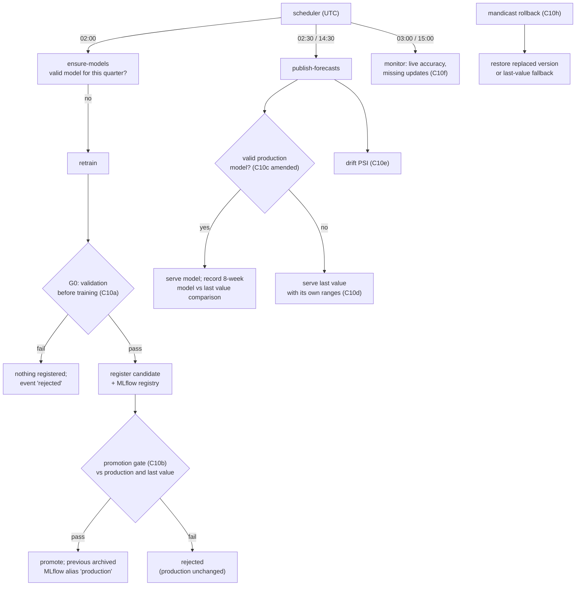

# MandiCast — MLOps: retraining, promotion gate, fallback, monitoring (Phase 5)

Date: 2026-11-27. Rules: `docs/06_forecasting_methodology.md` §9b (C10a–C10h), recorded before any of them was
computed. Generated result tables: `reports/phase5/PHASE5_TABLES.md` (from `reports/phase5/*.json`).

## 1. What was built

| Part | Where | Notes |
|---|---|---|
| Schema | Alembic `0004` | `model_events`, `monitoring_snapshots`; gate, status reason and MLflow version on `model_versions`; `served_by`, `model_point` on `forecasts`; decisions and drift on `forecast_runs` (docs/04) |
| Validation before training | `serving/gate.py` `validate_data` | data reaches the cutoff; ≥ 80% of the production model's examples; ≥ 1,000 gate examples; finite labels |
| Promotion gate | `serving/gate.py` `evaluate`, `serving/lifecycle.py` | integrity; not worse than last value; not more than 2% worse than the production model; on the candidate's early-stopping set |
| Lifecycle | `serving/lifecycle.py`, `serving/registry.py` | `retrain`, `ensure_models`, promote / reject / rollback, events, MLflow registry mirror (alias `production`) |
| Fallback and last-value ranges | `serving/publish.py` | last value only when no valid model exists; the 8-week model vs last-value comparison is stored and shown (automatic switching dropped after the development simulation) |
| Drift | `serving/publish.py` `drift` | PSI of 5 features against the model's reference (deciles of its early-stopping set) |
| Monitoring | `serving/monitor.py` | live WAPE (model, last value, served), coverage, direction per crop and day range; missing-update checks |
| CLI | `mandicast retrain`, `rollback`, `ensure-models`, `monitor`, `publish-forecasts --dry-run` | `train-model` is an alias of `retrain` (always gated) |
| API | `/v1/monitoring`, `/v1/models/history`; forecasts gain `served_by`, `fallback`, `live_accuracy`, `drift` | docs/07 |
| Scheduler | `scheduler.py` | `ensure_models` 02:00, publication 02:30/14:30, `monitor` 03:00/15:00 UTC |
| MLflow | experiment `mandicast-models` (artifacts under `experiments/mlruns`, absolute path); registry models `mandicast-lightgbm-<crop>` | The database is the source of truth; MLflow failures never block serving |

## 2. Results

### 2.1 Promotion gate backtest on real data (`scripts/backtest_gate.py`)

For each quarter start from 2025-10-01 to 2026-10-01 the candidate was trained exactly as `retrain` would train it
and gated against the previous quarter's model and last value on its early-stopping set (full table:
`reports/phase5/PHASE5_TABLES.md`).

- **24 of 25 real candidates passed as the gate was first recorded.** In every case the candidate beat last value
  on its gate set (e.g. Onion 2026-10-01: 8.87% vs 9.49%; Wheat 1.93% vs 2.20%). Tomato's 2026-10-01 candidate,
  which stopped after 2 trees, passed only by a hair (12.795% vs 12.799%).
- **Soyabean 2026-10-01 failed only rule (iii):** 5.25% against 5.14% for the 2026Q3 model (limit 5.24%). Because
  the previous model cannot serve a new quarter (C9b), rejecting it would have served last value (5.61%), worse than
  the candidate. Rule (iii) was amended accordingly (docs/06 §9b, 08:01): it blocks only when the production model
  could still serve; under the amendment this candidate passes.
- **All 15 deliberately worse candidates were rejected** (3 per crop at 2026-10-01): forecasts × 1.08, a model
  trained on shuffled labels for 200 rounds, and the predicted change reversed. Every one failed (ii) (not better
  than last value), most also (iii). The shuffled-label models collapse to almost exactly the last value (e.g.
  Soyabean 5.62% vs 5.61%), so they are rejected by a small margin; such a model would be harmless rather than
  useful, and rule (ii) correctly declines to call it an improvement.

### 2.2 Fallback rule simulation (`scripts/backtest_fallback.py`)

The rule as first recorded (serve last value for a day range when the model lost over the previous 8 weeks) was
simulated on all development and hold-out origins. On development data it triggered in six crop × day-range cases
and helped in one (Onion days 1–7: 7.16% vs 7.23%) and hurt in five (largest: Tomato days 8–14, 20.65% vs 20.38%);
Potato never triggered. **Automatic switching was therefore dropped** (amendment of 07:52): the model is served
whenever a valid one exists; the 8-week comparison is still computed at each publication and shown as a warning.
Last value is served only when no valid model exists. Check: the simulation's model-only hold-out WAPE by day range
equals docs/10's figures exactly (e.g. Onion days 1–7: 6.357% on 154,382 points).

### 2.3 Live system after Phase 5 (2026-11-27)

| Check | Result |
|---|---|
| Re-evaluation of the five production models (`retrain --cutoff 2026-10-01`) | deterministic retraining reproduced each artifact exactly (same SHA-256, same version); all five passed validation and the gate (no earlier production model existed, so (i) and (ii) decided): gate-set WAPE vs last value — Onion 8.87% / 9.49%, Potato 6.59% / 6.82%, Soyabean 5.25% / 5.61%, Tomato 12.79% / 12.80%, Wheat 1.93% / 2.20% |
| MLflow registry | each production model registered as `mandicast-lightgbm-<crop>` version 1 with alias `production` (`scripts/verify_phase5.py`: all checks OK, after fixing a missing alias found by that script) |
| Publication preview for 2026-11-23 (`--dry-run`, nothing written) | all crops served by the model; Onion days 1–7 flagged: over the previous 8 weeks the model's WAPE was 5.18% vs 5.09% for last value. Drift: warning for Onion (`last_vs_mean_28d` PSI 1.31), Wheat (`vol_28d` 0.38) and Soyabean (`chg_7d` 2.29, `last_vs_mean_28d` 3.41); notice for Tomato; Potato stable |
| Live monitoring (`monitor`) | first snapshot from the one publication so far (targets 24–26 Nov only): e.g. Onion 1,073 points, model 4.33% vs last value 4.39%, 80% coverage 83%. Marked as not yet reliable (one week) |
| Missing-update checks | none raised (ingestion 1.5 h old, data complete through 2026-11-25, latest Monday published, valid models) |
| Rollback drill (Soyabean) | `rollback` archived the model with no earlier version → no production model; a publication preview then served last value for all 1,232 points with its own ranges (385-day calibration); the scheduled `ensure-models` did **not** reinstate the rolled-back model (reported "not retried"); a manual `retrain` passed the gate and restored it; MLflow alias restored. All recorded in `model_events` |
| Tests | **95 passed** (77 earlier + 18 Phase 5: deliberately worse candidates rejected, validation, rule (iii) amendment, rollback and restore, re-evaluation failure, informational fallback, PSI, last-value-only publication, live metrics, operational checks, API views); ruff clean |

## 3. Limitations

- **The gate set is optimistic for the candidate** (it chose the number of trees); it guards against broken or clearly
  worse models, not small differences. Reported accuracy remains the hold-out evaluation plus live monitoring.
- **Live monitoring has one week of data.** It becomes informative after about four publications.
- **Drift warnings are frequent by construction:** one origin's cross-section is compared with ~15 weeks of
  reference pairs, so a market-wide move (all mandis rising together) shifts features such as `last_vs_mean_28d`
  for every mandi at once. Drift is reported, not acted on; no response to it has been evaluated.
- **Two rules were changed after seeing simulations** (C10c automatic fallback dropped; C10b (iii) made non-blocking
  when the previous model cannot serve). Both changes are dated, explained and made in the conservative direction
  (serve the evaluated model; never serve something worse than the rejected candidate), and neither altered a live
  decision; they are still post-hoc choices.
- Retraining is quarterly (the evaluated procedure), not weekly as the Phase 1 roadmap said.
- Phase 4/5 run from the virtual environment; containers, CI and alerting on monitoring warnings come in Phases 6–8.
