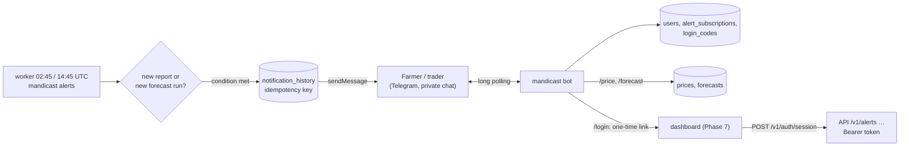

# MandiCast — Telegram bot and price alerts (Phase 6)

Date: 2026-11-27. Code: `src/mandicast/bot/` (client, commands, alerts, shared service), `src/mandicast/api/routes/
account.py` (sign-in and alert API). Schema: docs/04 (Alembic `0005`). API: docs/07 §6.

## 1. How it works

| Command | What it does |
|---|---|
| `/start`, `/help` | Registers the chat id, shows the commands and the privacy note |
| `/crops` | Crops covered |
| `/price onion lasalgaon` | Latest reported modal price (and min–max) with date, variety, grade and source; buttons when several mandis match |
| `/forecast onion lasalgaon` | Day 7 and day 14 forecast with the 80% range, whether the model or the last price served it, the measured hold-out accuracy, warnings and the disclaimer |
| `/alert <crop> <mandi> above\|below <₹>` | Message when a newly reported price is at or above / at or below the threshold (once per crossing, not every day) |
| `/alert <crop> <mandi> forecast <%>` | Message when a new weekly 7-day forecast moves at least that much from the last reported price (either direction) |
| `/alerts`, `/stop <n>` | List / remove my alerts (only my own) |
| `/login` | One-time dashboard link (15 minutes; code in the URL fragment) |
| `/privacy`, `/delete` | What is stored; delete everything (confirmed with a button) |

## 2. Design decisions

| Decision | Reason |
|---|---|
| Own small Bot API client on httpx instead of a bot framework | Four API methods are needed; the token handling, retries and test doubles stay fully under control |
| Long polling | No public HTTPS endpoint or open port needed on the laptop or in CI (architecture §4) |
| Private chats only; plain-text messages | No one's data appears in groups; market names or user text cannot inject formatting |
| Only the chat id is stored | Requirement: no personal data beyond what alerts need |
| Price alerts fire on crossing | A price that stays above a threshold would otherwise send a message every day |
| Idempotency keys (subscription + report date / forecast run) | A re-run, crash or retry never messages a user twice |
| Sign-in code in the URL fragment, hashed storage | The code never reaches server logs; a database leak exposes no usable code or token |
| Account endpoints never cached; separate writable connection | The shared Redis cache is keyed by URL, so per-user responses must bypass it; read endpoints stay read-only |

## 3. Security and privacy checks

| Requirement | Implementation | Test |
|---|---|---|
| Token never logged or leaked | Token only in the request URL; errors carry Telegram's description only; httpx URL logging at WARNING; redaction of anything shaped like a bot token; `.env` only | `test_client_retries_rate_limits_and_never_puts_the_token_in_errors` |
| Minimal personal data | `users` has no name/username/phone columns | `test_start_registers_only_the_chat_id_and_groups_are_ignored` |
| Authorization (IDOR) | Every query filtered by the caller's user id; foreign ids → 404 | `test_alert_commands_validate_and_only_touch_own_alerts`, `test_login_link_session_and_alert_api` |
| One-time, expiring sign-in | Code consumed atomically on exchange; expired codes refused; only hashes stored | `test_login_link_session_and_alert_api`, `test_expired_codes_and_sessions_are_refused_and_purged` |
| No caching of personal data | Gateway skips `/v1/alerts`, `/v1/me`, `/v1/auth` and any request with `Authorization`; `no-store` | `test_personal_responses_are_never_served_from_the_shared_cache` (real Redis) |
| Deletion and retention | `/delete` and `DELETE /v1/me` cascade; sessions/codes purged after expiry; notifications after 12 months | `test_delete_removes_everything`, `test_expired_codes_and_sessions_are_refused_and_purged` |
| Abuse limits | 20 commands per chat per minute; 20 alerts per user; input ≤ 200 characters; validated thresholds | `test_bot_rate_limit_per_chat` |
| Delivery robustness | 429 retried after `retry_after`; failures retried up to 5 runs; users who blocked the bot have their alerts paused | `test_blocked_user_alerts_are_paused_and_without_a_token_messages_wait` |

## 4. Verification (2026-11-27)

| Check | Result |
|---|---|
| `pytest` | **109 passed** (95 earlier + 14 Phase 6, with Telegram replaced by a recording mock transport) |
| `ruff check` | all checks passed |
| Simulated chat on the real database (mock transport, temporary chat id deleted afterwards) | `/price onion lasalgaon` offered 4 matching mandis; `/forecast onion lasalgaon(niphad)` returned day 7 ₹4,043 (80% range ₹3,738–₹4,575) and day 14 ₹4,013 with the hold-out accuracy (10.3% vs 11.1% at 14 days) and the disclaimer; `/alert … forecast 3` created an alert |
| **Real Telegram end-to-end run** | **Not done yet: needs `TELEGRAM_BOT_TOKEN` in `.env`** (see §5) |

## 5. Running it with a real bot

1. In Telegram, message **@BotFather**, send `/newbot`, choose a name and a username ending in `bot`.
2. Put the token in `mandicast/.env` as `TELEGRAM_BOT_TOKEN=…` (only there; `/revoke` in @BotFather replaces a
   leaked token).
3. Run `python -m mandicast bot` and message your bot `/start`, `/forecast onion lasalgaon`, `/alert …`.
4. `python -m mandicast alerts` (or the worker, 02:45 / 14:45 UTC) evaluates subscriptions and sends due messages.

## 6. Limitations

- English only (requirements §8 lists Hindi and other languages as an open question).
- Mandi search is by name substring; renamed mandis that Phase 2 could not link appear twice (e.g. "APMC Lasalgaon"
  and "Lasalgaon APMC"), shown as they appear in the source.
- Forecast alerts look at the 7-day point only and fire once per weekly publication.
- The bot runs as one process; it is not yet containerised or supervised (Phase 8).
