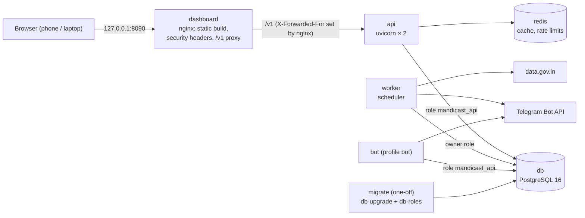

# MandiCast — Testing, infrastructure and operations (Phase 8)

Date: 2026-11-27. Files: `docker-compose.yml`, `docker/`, `.github/workflows/ci.yml`, `requirements-linux.lock.txt`,
`src/mandicast/db/roles.py`, `scripts/backup.sh`, `scripts/restore_check.sh`. Roadmap exit criteria (docs/08): CI green
on GitHub; failure-mode tests pass.

## 1. Deployment

| Service | Image / command | Receives | Published |
|---|---|---|---|
| `db` | postgres:16-alpine (digest-pinned) | owner credentials | 127.0.0.1:5433 (development) |
| `redis` | redis:8-alpine (digest-pinned), no persistence, 128 MB LRU | its password | 127.0.0.1:6380 (development) |
| `migrate` | app image: `db-upgrade` then `db-roles`, exits | owner URL, API role password | — |
| `api` | app image: `api --workers 2` | API-role URL, Redis URL, `API_TRUST_FORWARDED_FOR=true`, no CORS | not published (only via the dashboard's `/v1`) |
| `worker` | app image: `worker` | owner URL, data.gov.in key, bot token, dashboard URL; mounts data, models, reports, logs, experiments | — |
| `bot` (profile `bot`) | app image: `bot` | API-role URL, bot token, dashboard URL | — |
| `dashboard` | nginx-unprivileged 1.29 (digest-pinned) with the production build | — | 127.0.0.1:8090 |
| `mlflow` (profile `tools`) | app image: `mlflow ui` on `experiments/mlflow.db` | — | 127.0.0.1:5000 |

**Hardening (all app containers):** non-root users (uid 10001; nginx 101), read-only root file system with a `/tmp`
tmpfs, all Linux capabilities dropped, `no-new-privileges`, health checks (API: `/v1/health`; dashboard: `/`), log
rotation (10 MB × 5). Images are built from digest-pinned bases; Python packages install with `--require-hashes` from
`requirements-linux.lock.txt` (a wrong hash is refused: checked), npm packages with `npm ci` from the lockfile's
integrity hashes and no install scripts. `.dockerignore` keeps `.env`, data, models, logs and reports out of every
build context.

**Why one origin:** nginx serves the dashboard and proxies `/v1`, so the browser never needs CORS, the CSP can say
`connect-src 'self'`, and the headers that a `<meta>` tag cannot set (`frame-ancestors`, `X-Frame-Options`) are sent
(docs/14 §7). nginx also limits each address to 5 requests/s (burst 40) before the API's own per-minute limit, and
overwrites `X-Forwarded-For`, which is why the API may trust it: the API has no published port.

**Linux hosts:** Docker creates missing bind-mount folders as root. Before the first start run
`mkdir -p data models reports logs && sudo chown -R 10001 data models reports logs experiments` (the CI workflow does
this). Docker Desktop on Windows needs nothing.

## 2. Failure-mode tests

The nine failure modes listed in docs/08, plus two dependency outages. Each row names the tests that exercise it;
"added" marks tests written in this phase.

| Failure mode | Expected behaviour | Tests |
|---|---|---|
| Duplicate ingestion | Re-running loads nothing twice; a concurrent run is skipped | `test_load_is_idempotent`, `test_backfill_then_daily_is_idempotent_and_picks_up_corrections`, `test_identical_date_snapshot_is_not_stored_twice`, `test_same_rows_in_a_different_order_are_not_stored_again`, `test_concurrent_run_is_skipped` |
| Missing records | Gaps stay gaps; rows missing from pages are recovered from date snapshots; a shrunken snapshot is not applied | `test_date_snapshot_recovers_rows_missing_from_pages_without_duplicates`, `test_shrunken_snapshot_is_stored_but_not_applied`, `test_date_without_records_is_counted_not_stored`, `test_prices_are_primary_values_without_filling`, dashboard `PriceChart` gap tests |
| Invalid prices | Flagged, kept apart from inputs and headline values, never silently fixed | `test_flags_and_bounds_not_reported` (non-numeric, min > max, modal outside range), `test_local_outlier_is_flagged_from_past_values`, `test_outlier_value_is_not_an_input_but_is_a_flagged_target`, `test_database_rejects_inconsistent_intervals` |
| Source schema change | The load is refused and rolled back as a whole | `test_header_change_is_rejected`, `test_schema_change_rolls_back_the_whole_load`, `test_tampered_file_is_detected` |
| API schema change | The dashboard's copy of the schema must match | `test_dashboard_schema_snapshot_matches_the_api` |
| Source API failure | Retries with back-off, then a recorded job failure without the key | `test_retries_transient_errors_then_succeeds`, `test_gives_up_after_retries_without_leaking_key`, `test_connection_error_is_retried`, `test_short_page_is_retried_then_fails`, `test_job_success_and_failure_are_recorded_with_secrets_redacted` |
| **Database down** (added) | Health 503 `down` within the connect timeout; data endpoints give the generic error; no URL, host or password in responses | `test_database_outage_is_reported_and_leaks_nothing` |
| **Redis down** (added) | Responses served uncached, in-process rate limit, health `degraded` | `test_api_keeps_serving_when_redis_is_unreachable` |
| Retraining failure | Rejected or crashed candidates never replace production; validation failures register nothing; **a crash in the scheduled job is recorded and changes nothing** (added) | `test_validation_failure_registers_nothing`, `test_failed_gate_rejects_candidate_and_keeps_production`, `test_gate_rejects_deliberately_worse_candidates`, `test_training_crash_in_the_scheduled_job_keeps_production_and_records_the_failure` |
| Insufficient data | No forecast; the failed rule is reported (API and dashboard) | `test_forecast_insufficient_data_and_eligibility`, `test_eligibility_uses_only_data_up_to_the_origin`, dashboard component and end-to-end tests |
| Rollback | The previous model returns; the scheduler does not reinstate a rolled-back one | `test_passed_gate_promotes_then_rollback_restores`, `test_production_model_failing_reevaluation_is_rolled_back_and_rejected` |
| Notification failure | Blocked users' alerts are paused; **5xx answers are retried on later runs up to 5 times, then given up, without duplicates** (added); idempotent delivery | `test_blocked_user_alerts_are_paused_and_without_a_token_messages_wait`, `test_transient_telegram_failures_are_retried_on_later_runs_then_given_up`, `test_price_and_forecast_alerts_are_sent_once`, `test_client_retries_rate_limits_and_never_puts_the_token_in_errors` |

**Defect found by the database-outage test and fixed:** without a connect timeout psycopg waited 130 s per attempt
when the database host did not answer (measured: 130.0 s; 3.0 s with `connect_timeout=3`), so during an outage every
request and health check would have hung for minutes. All engines now use `DB_CONNECT_TIMEOUT_S` (default 5 s); the
test asserts the answer comes within 20 s.

## 3. Least-privilege database role

`python -m mandicast db-roles` (run by `migrate`) creates or updates `mandicast_api` with the password
`API_DB_PASSWORD`: SELECT on every table, INSERT/UPDATE/DELETE only on `users`, `login_codes`, `user_sessions`,
`alert_subscriptions`, `notification_history`, the sequences of those five tables, no schema rights, a 15 s statement
timeout and 40 connections. Future tables become readable automatically (default privileges). Identifiers are quoted
by the server (`quote_ident`) and the password by `quote_literal`; nothing is interpolated unquoted.

`tests/test_db_roles.py` checks with a real role on the test database: reads work; updating prices, deleting models,
inserting commodities, `CREATE TABLE`, `DROP TABLE` and `TRUNCATE users` are refused; sign-in, alert creation and
account deletion (cascading) work; the API serves and signs users in when connected as the role. The Compose `api`
and `bot` use it; the pipeline and worker keep the owner account.

## 4. Continuous integration

`.github/workflows/ci.yml` (push to `main`, pull requests, manual), read-only token, actions pinned to commit SHAs
(checkout v7.0.1, setup-python v7.1.0, setup-node v7.1.0):

| Job | Steps |
|---|---|
| backend | PostgreSQL and Redis service containers (same images as Compose; trust authentication instead of a password in the file); hash-checked install; ruff; pytest; `pip-audit` 2.10.1 on the lock |
| dashboard | `npm ci --ignore-scripts`; typecheck; ESLint; Vitest; production build; `npm audit --audit-level=high` |
| images | throwaway `.env` with random values (`openssl rand`); `docker compose config`; build both images; start db, redis, migrate, api and dashboard on an empty database; smoke test through nginx (health, data, CSP with `frame-ancestors`, API not reachable directly) |

Not in CI: the Playwright tests, which need the full price database (run locally: `npm run test:e2e`, or against
the Compose stack with `E2E_BASE_URL=http://localhost:8090`).

## 5. Verification (executed 2026-11-27)

| Check | Result |
|---|---|
| `pytest` on Windows (development venv) | **116 passed** (110 + 4 failure modes + 2 role tests); ruff clean |
| CI backend job, reproduced: test image built from exactly the files a clone would contain (`git ls-files -co --exclude-standard`, 304 files), run in Linux against the Compose PostgreSQL and Redis | **116 passed**, ruff clean |
| CI dashboard job commands | typecheck, lint, **29 passed**, build, `npm audit`: 0 vulnerabilities |
| `pip-audit` on the hash-locked Linux requirements (CI command) | No known vulnerabilities found (122 packages) |
| Hash checking | a deliberately wrong hash is refused (`THESE PACKAGES DO NOT MATCH THE HASHES`) |
| CI images job, reproduced as a separate Compose project with its own empty volume and ports | migrations 0001→0005 from scratch, role created, API and dashboard healthy, CSP header present; project and its volume removed afterwards |
| Full stack on the real database (`docker compose up -d`) | all services healthy; health `ok` through nginx (database via `mandicast_api`, 5 model artifacts, Redis); API not reachable from the host; containers run as uid 10001 / 101 on read-only file systems; worker scheduler started |
| Playwright end-to-end against the Compose stack (`E2E_BASE_URL=http://localhost:8090`) | **7 passed** (no CSP violations with nginx's header policy) |
| MLflow UI (profile `tools`) | serves experiments and the registered models `mandicast-lightgbm-*` |
| Bot without a token (profile `bot`) | exits with code 1 and "TELEGRAM_BOT_TOKEN is not set" |
| Backup and restore of the live database | 1.1 GB in 163 s; restored in 310 s; 21 tables, 29,717,867 rows, identical counts (§6) |
| GitHub Actions run | **not done: no GitHub repository yet** |

## 6. Backups

`scripts/backup.sh` runs `pg_dump` (custom format, compression 6) inside the db container over its local socket, so no
password is passed on a command line; writes `backups/mandicast-<UTC time>.dump` and its SHA-256; checks that the
archive's table of contents can be read; keeps the newest 7 (`BACKUP_KEEP`), because backups contain users' chat ids
and alerts. `scripts/restore_check.sh` verifies the checksum, restores into a temporary database `mandicast_restore_check`
(4 parallel jobs, stop on the first error), compares the row count of every table with the live database, and drops
the temporary database even when a step fails.

| Run (2026-11-27, worker stopped for consistent counts) | Result |
|---|---|
| Backup of the live database (10 GB on disk incl. indexes) | `mandicast-20261127T143344Z.dump`: **1.1 GB in 163 s**, 21 tables with data, checksum written |
| Restore check | checksum OK; restored in **310 s**; **21 tables, 29,717,867 rows, every count identical** (e.g. `price_observations` and `source_observations` 14,831,605, `forecasts` 28,042, `model_versions` 5); temporary database and copied file removed |

**Defects found while testing the scripts and fixed:** the first restore-check run printed "restore OK: 0 tables":
its generated count queries lacked semicolons, both sides counted nothing, and an empty comparison passed. The
restore itself had succeeded, but the check proved nothing. The script now stops on any SQL error and fails unless
every table produced a numeric count. That run also left its 1.1 GB copy of the dump in the container: Git Bash
rewrote the `/tmp/...` path of the clean-up command into a Windows path. Every in-container command now runs through
`sh -c`, and clean-up runs on exit whatever happens.

**Restoring for real:** stop the app services (`docker compose stop api worker bot`), create an empty database, run
`pg_restore --jobs=4 --exit-on-error` as in the script (the `mandicast_api` role must exist first: `db-roles`, or add
`--no-acl`), point `POSTGRES_DB` at it or rename it, start the services. Copies off this machine (and their
encryption) are the operator's choice.

## 7. Operations

| Task | Command |
|---|---|
| Start / stop | `docker compose up -d` / `docker compose stop` (data stays in the `pgdata` volume) |
| Status and logs | `docker compose ps`; `docker compose logs -f api worker` (JSON lines; secrets redacted) |
| Upgrade | pull the code, `docker compose up -d --build` (`migrate` applies new migrations before the API starts) |
| One-off job | `docker compose run --rm worker daily` (any `mandicast` command, e.g. `retrain`, `rollback --commodity X --reason "…"`) |
| Model rollback | `docker compose run --rm worker rollback --commodity Onion --reason "…"` (docs/12) |
| Rotate the API role password | change `API_DB_PASSWORD` in `.env`, then `docker compose up -d migrate api bot` |
| Telegram token leaked | `/revoke` in @BotFather, put the new token in `.env`, `docker compose --profile bot up -d bot worker` |
| Restore | `pg_restore` the dump into an empty database (see `scripts/restore_check.sh` for the exact commands) |

## 8. Limitations

- The CI workflow has not run on GitHub (no repository yet); its three jobs were reproduced locally as described in
  §5, which is evidence, not a green run.
- The app image is 1.78 GB (MLflow, Polars, PyArrow, LightGBM, statsforecast in one image); the API does not need most
  of it. Split images would be smaller.
- The hash-locked requirements are for linux/amd64; other architectures need their own lock.
- No TLS: everything is bound to 127.0.0.1. A public deployment needs HTTPS in front of nginx (then add
  Strict-Transport-Security) and should keep the database and Redis unpublished.
- The worker has no health check (APScheduler has no endpoint); a stalled scheduler shows up as missing-update
  warnings in `/v1/monitoring` (C10f).
- Backups stay on the same machine; copies elsewhere (and their encryption) are up to the operator.
